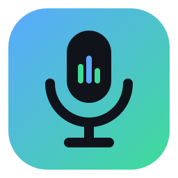
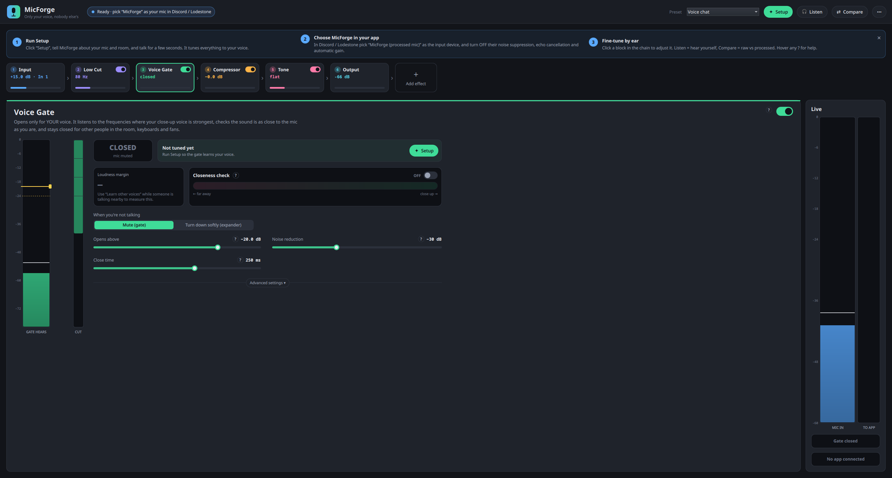
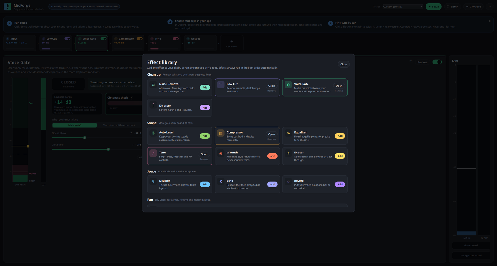
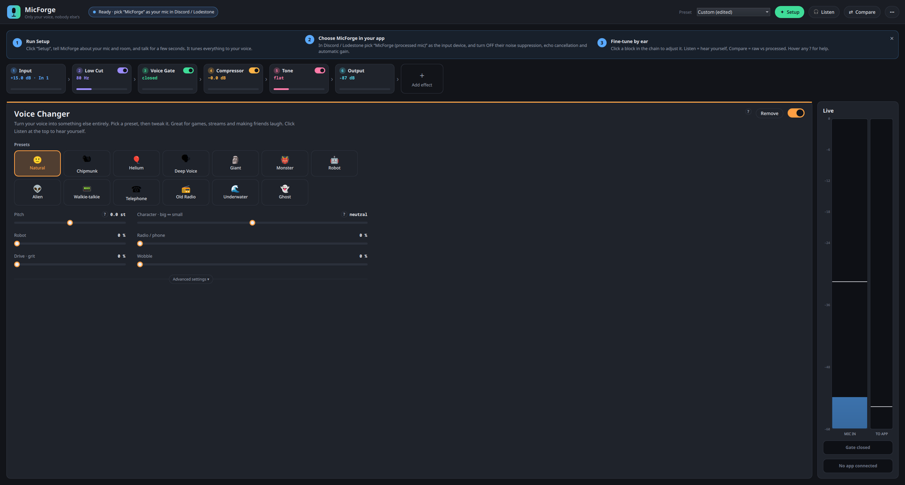
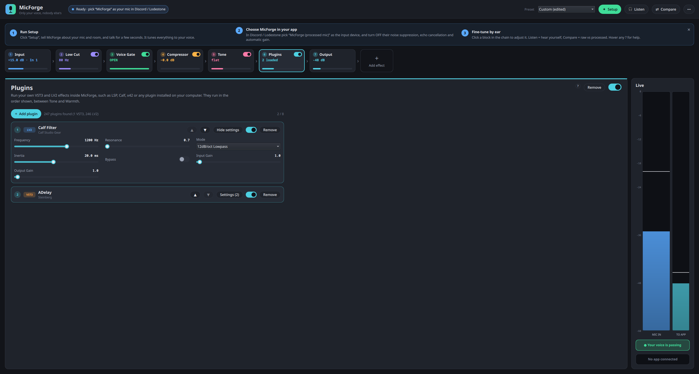

<p align="center"></p>

<h1 align="center">MicForge</h1>
<p align="center"><b>Only your voice, nobody else's.</b><br>
A microphone processor for Linux (PipeWire) that cleans up your mic for Discord, games, streaming and recording.</p>



MicForge creates a virtual microphone called **"MicForge (processed mic)"**. Pick it as your
input device in Discord, OBS or any other app, and everyone hears your processed voice.

> **Built with Claude.** MicForge is developed with [Claude](https://claude.ai), Anthropic's AI model,
> using Claude Code. See [Built with Claude](#built-with-claude) below.

## Highlights

- **Guided setup.** Tell it your mic type and situation, talk for a few seconds, and it tunes
  the gain, gate and compressor to your voice and room. Any recording that goes wrong can be redone on its own.
- **Keeps other people off your mic.** The Voice Gate listens to the frequencies where *your*
  close-up voice is strongest. A "closeness check" then rejects voices from across the room,
  even when they laugh or shout. Nobody else has to take part in setup.
- **15 built-in effects**, each one optional and removable, grouped in an Effect Library:
  - *Clean up:* AI Noise Removal (RNNoise), Low Cut, Voice Gate, De-esser
  - *Shape:* Auto Level, Compressor, Equaliser (draggable 5-point graph), Tone, Warmth, Exciter
  - *Space:* Doubler, Echo, Reverb
  - *Fun:* Voice Changer with presets (Chipmunk, Helium, Deep Voice, Giant, Monster, Robot,
    Alien, Walkie-talkie, Telephone, Old Radio, Underwater, Ghost)
- **Your own plugins.** Load any installed **VST3** or **LV2** effect (LSP, Calf, x42 and others)
  into the chain, with generated controls for every setting.
- **Built for non-experts.** Plain-English names and help on every control, live meters
  everywhere, A/B "Compare" with your raw mic, "Listen" to hear yourself, and a one-click **Mute**
  (also in the tray and on Ctrl+M).
- An **Overview** page that shows at a glance what your apps are hearing, plus pages for Voice
  Isolation, Effects, Audio Devices, Presets and Settings. Light and dark themes, full keyboard control.
- Runs in the system tray, and can start automatically when you log in (Settings → Startup).

| Effect Library | Voice Changer | Plugins |
|---|---|---|
|  |  |  |

## Install

### Arch Linux / CachyOS / Manjaro (AUR)

```bash
yay -S micforge        # latest release
yay -S micforge-git    # latest development version
```

### Any distribution: build from source

Dependencies: Qt 6 (base, declarative, svg), PipeWire, rnnoise, lilv, lv2 headers, a C++20 compiler and git.

```bash
git clone --recursive https://github.com/stuartw-source/micforge.git
cd micforge
./install.sh            # builds and installs into ~/.local (no root needed)
```

Or system-wide:

```bash
./scripts/fetch-vst3sdk.sh
mkdir build && cd build
qmake6 PREFIX=/usr ../micforge.pro
make -j$(nproc)
sudo make install
```

## Getting started

1. Open MicForge and click **Setup**. Choose your mic and situation, then follow the steps (about 20 seconds).
2. In your voice app, pick **"MicForge (processed mic)"** as the input device. Turn **off** the app's own
   noise suppression, echo cancellation and automatic gain, or they'll fight MicForge.
3. Click any block in the chain to fine-tune it, or **+ Add effect** for more.

## How it works

Audio from your mic is processed in this order:

Input → AI noise removal → Low cut → Voice gate → Auto level → Compressor → De-esser →
Voice changer → Equaliser → Tone → **Your plugins** → Warmth → Exciter → Doubler → Echo →
Reverb → Output (safety limiter)

The Voice Gate's detector uses a frequency band and a closeness measure (bass vs. treble) learned
during Setup. Because a voice close to the mic gets a strong bass boost (the proximity effect),
voices further away are recognised regardless of how loud they are.

Third-party VST3 plugins are discovered in a separate helper process, so a broken plugin can't
crash MicForge. If a plugin crashes while loading, it's switched off automatically on the next start.

## Development

| Path | What's there |
|---|---|
| `src/dsp.h`, `src/effects.h` | Realtime processing chain and effects |
| `src/separation.h` | Voice-separation analysis used by Setup |
| `src/audioengine.*` | PipeWire streams (mic in, virtual mic out, monitor) |
| `src/plugins/` | VST3 (Steinberg SDK hosting helpers) and LV2 (lilv) hosting |
| `src/controller.*`, `src/pluginmanager.*` | Settings, presets, setup wizard, plugin management |
| `qml/` | User interface |
| `packaging/aur/` | AUR `PKGBUILD`s |
| `docs/REQUIREMENTS.md` | Why MicForge exists and what it must do |

Tests:

```bash
g++ -std=c++20 -O2 -Isrc tests/dsp_test.cpp -lrnnoise -o dsp_test && ./dsp_test
```

Useful environment variables: `MICFORGE_TEST=1` runs a separate test instance (own settings and
virtual mic) next to your real one. `MICFORGE_PAGE=<stage>`, `MICFORGE_SNAPSHOT=<file.png>`,
`MICFORGE_SETUP=1` and `MICFORGE_LIBRARY=1` are for screenshots. `VST3_PATH` adds extra VST3 folders.

## Built with Claude

MicForge is built using **Claude** (Anthropic's AI model) through **Claude Code**. The code, DSP, tests,
packaging and documentation are written with Claude, directed by the project maintainer, who sets the
requirements, tests every change on real hardware, and decides what ships. Commits written with Claude
carry a `Co-Authored-By: Claude` trailer.

If you find a problem, please open an issue. Every report is read by a human.

## Licence

MicForge is free software under the **GNU General Public License v3.0 or later** (see [LICENSE](LICENSE)).

It includes parts of Steinberg's **VST 3 SDK**, which is MIT-licensed
(see `third_party/vst3sdk/*/LICENSE.txt`). VST is a registered trademark of Steinberg Media Technologies GmbH.
Noise removal uses **RNNoise** (BSD). LV2 hosting uses **lilv** (ISC).
